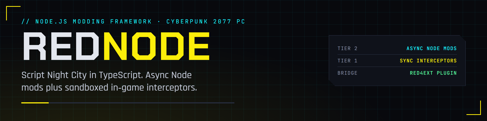

<p align="center">
  
</p>

<p align="center">
  <a href="https://cyberbuildsex.github.io/REDnode/"></a>
  
  
  
  
  <a href="LICENSE"></a>
</p>

A Node.js API for scripting Cyberpunk 2077 (PC, single-player).

REDnode attaches to the game through the same injection points as RED4ext and Cyber Engine Tweaks, and exposes the game's reflection (RTTI) system to TypeScript and JavaScript.

**[Read the docs](https://cyberbuildsex.github.io/REDnode/)** &middot; [API reference](https://cyberbuildsex.github.io/REDnode/api/) &middot; [Design](https://cyberbuildsex.github.io/REDnode/design.html)

> [!NOTE]
> **Status: design phase.** The P1 probe plugin builds and is waiting for its in-game test. The `rednode` SDK is a design sketch, so every function throws for now. The roadmap is below.

## How it works

REDnode has two tiers.

| | Tier 2: async mods | Tier 1: interceptors |
|---|---|---|
| Runs in | A separate Node process | The game process, sandboxed |
| Can | Observe events, query state, send commands | Change arguments or return values inside a hook |
| Cannot | Block the game | `await`, do I/O, run long |
| Language | TypeScript / JavaScript with npm | Restricted JavaScript (QuickJS), compiled from TypeScript |

A thin native RED4ext plugin bridges the two. It exposes the game's RTTI over IPC and queues all game access onto the game thread.

```
 Game process                          Node process
 ┌──────────────────────────┐          ┌──────────────────────┐
 │ game thread + hooks      │          │ Tier 2 mods          │
 │ Tier 1 interceptors      │  pipe    │ rednode SDK          │
 │ native plugin (RED4ext)  │◄────────►│ hot reload, tooling  │
 └──────────────────────────┘          └──────────────────────┘
```

Simple synchronous behavior ("multiply incoming damage by 0.5") can also be declared as a native rule that needs no JS engine at all.

## Repository layout

| Path | Contents |
|---|---|
| `docs/` | Design document |
| `native/` | RED4ext plugin: RTTI bridge, IPC server, hooks (not started) |
| `packages/rednode/` | Node SDK: typed API for both tiers (stubs only) |

## Roadmap

- **P0 Research.** Map the RED4ext plugin ABI. Inspect how Cyber Engine Tweaks hooks and resolves addresses.
- **P1 Proof.** Hello-world RED4ext plugin that logs the RTTI class count.
- **P2 Tier 2.** Pipe bridge and Node SDK: events, queries, commands, generated types.
- **P3 Rules.** Declarative native rules applied inside hooks with no IPC.
- **P4 Tier 1.** QuickJS interceptors with time limits, ordering and fault handling.

## Compatibility goals

REDnode should coexist with Cyber Engine Tweaks, RED4ext plugins, redscript and REDmod. It will use RED4ext's hooking and the Address Library instead of hard-coded offsets, so mods survive game patches.

## Legal

Single-player modding only. This repository contains no game files and no data extracted from them. Check CD Projekt's modding terms before distributing anything built with it.

## License

[MIT](LICENSE)
