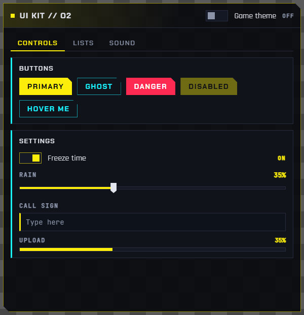
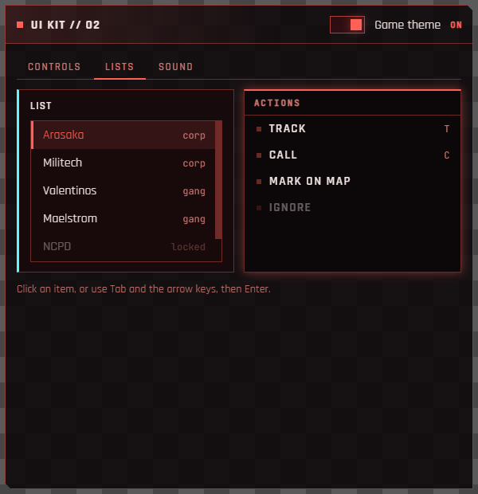
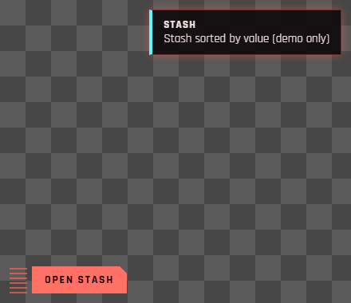

# Overlay apps

Overlay apps are small web apps drawn on top of the game: HTML, CSS and JavaScript. They talk to the game through the `rednode` package and can play the game's own UI sounds. [Node mods](#node-mods) use the same package from Node, and can open windows without writing HTML. Every app example on this page was tested in game on 2026-10-11 (Cyberpunk 2077 2.31), and the Node mod and game API examples on 2026-10-12.

Status: **developer preview.** See the [overlay design](overlay.md) for how it works and what is planned.

## How an app runs

| Part | What it does for your app |
|---|---|
| Overlay host (Electron, outside the game) | Renders your page off-screen and streams it to the game. Gives your page `window.rednode` |
| REDnode plugin (inside the game) | Draws your window, moves it when dragged, and sends you mouse and keyboard input |
| Bridge | Runs your game calls on the game thread and returns the answer as a promise |

In the game, **F10** cycles three modes: passive (your window is drawn, the game gets input), interactive (your window gets input) and hidden. **Esc**, or a click on empty screen, returns input to the game.

## Your first app

An app is a folder with a manifest and a page. Put it in the apps folder: `packages/overlay/apps/` in the repo, or `red4ext/plugins/REDnode/apps/` in the game folder.

`hello/rednode-app.json`:

```json
{
  "id": "hello",
  "name": "Hello Night City",
  "version": "0.1.0",
  "author": "you",
  "description": "Shows where V is.",
  "entry": "index.html",
  "width": 360,
  "height": 200,
  "anchor": "top-left",
  "x": 100,
  "y": 100
}
```

`hello/index.html`:

```html
<!doctype html>
<html>
<head>
<meta charset="utf-8">
<script src="rednode://ui/rednode-ui.js"></script>
<style>
  html, body { margin: 0; width: 360px; height: 200px; background: transparent; }
  rn-window { position: absolute; inset: 6px; }
</style>
</head>
<body>
  <rn-window title="Hello Night City" draggable>
    <rn-button id="where">Where am I?</rn-button>
    <p id="out"></p>
  </rn-window>
  <script>
    document.getElementById('where').addEventListener('click', async () => {
      const p = await window.rednode.call('player.position');
      document.getElementById('out').textContent = `X ${p.x.toFixed(1)}  Y ${p.y.toFixed(1)}  Z ${p.z.toFixed(1)}`;
    });
  </script>
</body>
</html>
```

Start the game, press F10, open the **REDNODE** launcher tab at the lower left and switch **Hello Night City** on. Load a save and click the button. All manifest fields are listed in the [overlay host README](https://github.com/Edgemodders/REDnode/tree/main/packages/overlay#apps-and-manifests).

| Rule | Why |
|---|---|
| Keep the page background **transparent** | Transparent pixels show the game, and clicks on them pass through to whatever is behind |
| Give the page the window's **fixed size** | Pages are drawn 1:1 at 1080p and scaled with the screen height: 2x at 4K |
| **Don't draw a cursor** | The plugin draws it, at the game's frame rate |

## A titled window from markup

The [UI kit](https://github.com/Edgemodders/REDnode/tree/main/packages/ui) turns markup into widgets. This is the test app [`apps/kit`](https://github.com/Edgemodders/REDnode/tree/main/packages/overlay/apps/kit), cut down:

```html
<rn-window id="win" title="UI kit // O2" draggable>
  <rn-toggle id="theme" slot="status" label="Game theme"></rn-toggle>
  <rn-tabs>
    <rn-tab label="Controls">
      <rn-panel title="Settings">
        <rn-toggle label="Freeze time" checked></rn-toggle>
        <rn-slider id="rain" label="Rain" min="0" max="100" value="35" unit="%"></rn-slider>
        <rn-input id="name" label="Call sign" placeholder="Type here"></rn-input>
        <rn-progress id="progress" label="Upload" value="35"></rn-progress>
      </rn-panel>
    </rn-tab>
    <rn-tab label="Lists">
      <rn-list id="list">
        <rn-item value="arasaka" selected>Arasaka <span slot="end">corp</span></rn-item>
        <rn-item value="militech">Militech <span slot="end">corp</span></rn-item>
      </rn-list>
    </rn-tab>
  </rn-tabs>
</rn-window>
```

The script only wires events:

```js
document.getElementById('theme').addEventListener('change', (e) => {
  document.getElementById('win').setAttribute('theme', e.detail.checked ? 'game' : 'rednode');
});
document.getElementById('rain').addEventListener('input', (e) => {
  document.getElementById('progress').setAttribute('value', e.detail.value);
});
document.getElementById('list').addEventListener('select', (e) => {
  RednodeUI.notify(`Selected ${e.detail.value}`, { title: 'List' });
});
```

| `theme="rednode"` | `theme="game"` |
|---|---|
|  |  |

The grey checkerboard in these captures is the transparent part of the page. In game, the game shows there.

## A native-looking button

No window frame at all: a borderless page with one game-style button and its menu. The rest of the page is transparent, so it looks like part of the game's UI. From [`apps/native`](https://github.com/Edgemodders/REDnode/tree/main/packages/overlay/apps/native):

```html
<body theme="game">
  <rn-menu id="menu" title="Stash" hidden>
    <rn-menu-item value="sell">Sell junk <span slot="end">12</span></rn-menu-item>
    <rn-menu-item value="sort">Sort by value</rn-menu-item>
    <rn-menu-item value="close">Close</rn-menu-item>
  </rn-menu>
  <div class="grip" data-rednode-drag></div>
  <rn-button id="open" sound="ui_menu_onpress">Open stash</rn-button>
</body>
```

```js
const menu = document.getElementById('menu');
document.getElementById('open').addEventListener('click', () => { menu.hidden = !menu.hidden; });
menu.addEventListener('select', (e) => {
  menu.hidden = true;
  if (e.detail.value !== 'close') RednodeUI.notify(`Picked ${e.detail.value}`, { title: 'Stash', theme: 'game' });
});
```



Any element with `data-rednode-drag` is a drag handle; here, a small striped grip. `<rn-window draggable>` makes its title area the handle.

## A HUD widget

A HUD widget is drawn over the game but never takes input, like the game's own HUD. Set `"kind": "hud"` in the manifest, and list in `"hideWith"` when the game should hide it. From [`apps/coords`](https://github.com/Edgemodders/REDnode/tree/main/packages/overlay/apps/coords):

```json
{
  "id": "coords",
  "name": "Coords HUD",
  "entry": "index.html",
  "kind": "hud",
  "hideWith": ["menu", "photo-mode", "scene", "main-menu"],
  "width": 520,
  "height": 72,
  "anchor": "top",
  "x": 0,
  "y": 14
}
```

| `hideWith` value | Hidden while |
|---|---|
| `menu` | A game menu is open: inventory, map, pause and so on |
| `photo-mode` | Photo mode is on |
| `scene` | A cinematic scene plays (the game's scene tier 4 or higher; unverified) |
| `main-menu` | There is no player: the main menu and loading screens |

The REDnode plugin does the hiding, in the same frame the game changes state. To react in the page as well, listen for `ui-state`:

```js
window.rednode.on((m) => {
  if (m.event === 'ui-state') console.log(m.menu, m.photoMode, m.scene, m.mainMenu, m.sceneTier);
});
```

## Playing game sounds

Sounds play through the game's own audio system, so they mix with the game and follow its volume settings. The bridge call `audio.play` runs the game's native `AudioSystem.Play` with no entity, the way the game plays its 2D UI sounds.

Three ways, from simplest to most control:

```html
<!-- 1. An attribute on a UI kit widget: plays on press -->
<rn-button sound="ui_menu_onpress" hover-sound="ui_menu_hover">Apply</rn-button>
```

```js
// 2. The kit's helper. Never throws; silently skipped outside the game.
RednodeUI.playSound('ui_jingle_quest_success');

// Or set a default for every press in the app:
RednodeUI.sounds.press = 'ui_menu_onpress';

// 3. The bridge call itself. Resolves when the game has played it.
await window.rednode.call('audio.play', { name: 'ui_loot_take_all' });
```

Sound event names confirmed in game on 2026-10-11:

| Name | Use |
|---|---|
| `ui_menu_onpress` | Button press |
| `ui_menu_hover` | Hover |
| `ui_menu_tutorial_close` | Closing a panel |
| `ui_loot_take_all` | Taking items |
| `ui_menu_item_bought` | A purchase |
| `ui_jingle_quest_success` | A success jingle |

The game has many more. An unknown name plays nothing and is not an error, so the kit app's **Sound** tab is the quickest way to try one. The same call from redscript is in the game API reference: [AudioSystem.Play](game/t/gameGameAudioSystem.html#Play).

## Talking to the game

Import the `rednode` package, the same one Node mods use. An import map lets the page import it by name; the host serves it at `rednode://sdk/index.js`. This is the [Coords HUD](https://github.com/Edgemodders/REDnode/tree/main/packages/overlay/apps/coords) app:

```html
<script type="importmap">{ "imports": { "rednode": "rednode://sdk/index.js" } }</script>
<script type="module">
  import { game } from 'rednode';

  setInterval(async () => {
    try {
      const p = await game.player.position();   // { x, y, z }; fails at the main menu
      document.getElementById('x').textContent = p.x.toFixed(1);
    } catch {
      // no player yet
    }
  }, 500);
</script>
```

| Call | What it does |
|---|---|
| `game.player.position()` | V's world position. Rejects at the main menu, where there is no player |
| `game.audio.play(name)` | Plays a game sound event |
| `game.on(name, handler)` | A game event. Today `"PlayerPuppet.OnGameAttached"`, at the main menu and on every save load |
| `game.state()`, `game.onState(handler)` | Whether a menu, photo mode, a scene or the main menu is showing, the overlay mode, and whether the game is linked |
| `game.call(method, params)` | Any bridge method by name, for example `"game.info"` |

The full list, with examples, is in the [API reference](api/). For anything else in the game, use the [game API](#the-game-api).

The older `window.rednode` calls still work, and the overlay events `focus` and `overlay` come only through it:

```js
window.rednode.on((m) => {
  if (m.event === 'focus') console.log('focused:', m.focused); // dim your title when false
  if (m.event === 'overlay') console.log('mode:', m.mode);   // passive, interactive or hidden
});
```

## Node mods

A Node mod is Node code that runs in the REDnode host, outside the game: full Node and npm, `await` anywhere, and the game never waits for it. It is a folder with a manifest that has `main` instead of `entry`:

```json
{
  "id": "hello-mod",
  "name": "Hello mod",
  "version": "0.1.0",
  "author": "Edgemodders",
  "description": "A Node mod with a window built by the rednode ui builder.",
  "main": "mod.mjs",
  "open": true
}
```

A mod opens windows with the **ui builder**: a tree of nodes, rendered by the host with the UI kit. No HTML. This is the [Hello mod](https://github.com/Edgemodders/REDnode/tree/main/packages/overlay/apps/hello-mod), shortened:

```js
import { game, ui } from 'rednode';

const where = ui.text('Waiting for the game...');

ui.window({
  title: 'Hello mod',
  anchor: 'right',
  x: -40,
  children: [
    ui.heading('Where is V'),
    where,
    ui.row(
      ui.button('Play sound', () => game.audio.play('ui_menu_onpress')),
      ui.toggle('Follow', (on) => console.log('Follow', on), { checked: true }),
    ),
  ],
});

setInterval(async () => {
  try {
    const p = await game.player.position();
    where.set({ text: `X ${p.x.toFixed(1)}   Y ${p.y.toFixed(1)}   Z ${p.z.toFixed(1)}` });
  } catch (err) {
    where.set({ text: err.message, tone: 'dim' });
  }
}, 500);

game.on('PlayerPuppet.OnGameAttached', () => console.log('A save was loaded'));
```

| Node | Makes |
|---|---|
| `ui.text(text, { tone })`, `ui.heading(text)` | Text. `tone` is `dim`, `accent` or `danger` |
| `ui.button(label, onClick, { variant, sound })` | A button. `variant` is `ghost` or `danger` |
| `ui.toggle(label, onChange, { checked })` | An on and off switch |
| `ui.slider(label, onChange, { min, max, step, value, unit })` | A slider |
| `ui.input({ label, placeholder, value, onChange, onSubmit })` | A text field |
| `ui.progress(value, { label, max })` | A progress bar |
| `ui.row(...nodes)`, `ui.column(...nodes)` | Layout |
| `ui.window({ title, width, height, anchor, x, y, children, onClose })` | Opens the window. The player can drag it in interactive mode, and its position is saved |

Every node has `set(props)`, which updates the open window at once.

| Good to know | |
|---|---|
| Output | `console.log` goes to `red4ext/logs/rednode-mods.log`, tagged with the mod id. Open the built-in **Mod log** app from the launcher to watch it live in game; **Copy** puts the lines shown on the clipboard, ready to paste into a bug report. A crash shows only the stack lines in your own code |
| Isolation | Each mod runs on its own thread in a mod process. A thrown error, an endless loop or `process.exit()` stops only your mod. The launcher shows it as **CRASHED** or **NOT RESPONDING** with a **Restart** button |
| Memory | A mod process costs about 80 MB. Players can put mods in one **shared process** with the launcher; three mods then took about 92 MB in total. A native crash in the shared process stops every mod in it, so a mod with native addons should set `"isolation": "process"` |
| Hot reload | With the launcher's **Hot reload** switch on, saving a mod's file restarts the mod, and saving an app's file reloads its page |
| `.mjs` | Use the `.mjs` extension for `import` syntax, or add a `package.json` with `"type": "module"` |

## The game API

`api` calls any game function by name: global functions, the static functions of a class, and the methods of game objects. It is typed from the game's own type data, the same data as the [game API reference](game/), so an editor completes every class, method and enum member. It works the same in Node mods and in apps.

This is the [Vitals](https://github.com/Edgemodders/REDnode/tree/main/packages/overlay/apps/vitals) app, which shows V's health, level and money. The [Game API mod](https://github.com/Edgemodders/REDnode/tree/main/packages/overlay/apps/api-mod) reads the same from Node:

```js
import { api, game } from 'rednode';

const player = await api.GetPlayer(game.instance);                  // GetPlayer(GameInstance)
const statsId = await api.$call('Cast;EntityID;StatsObjectID', await player.GetEntityID());
const pools = await api.GameInstance.GetStatPoolsSystem(game.instance);
const stats = await api.GameInstance.GetStatsSystem(game.instance);
const shop = await api.GameInstance.GetTransactionSystem(game.instance);

const health = await pools.GetStatPoolValue(statsId, 'Health', false);
const level = await stats.GetStatValue(statsId, 'Level');
const eddies = await shop.GetItemQuantity(player, await api.MarketSystem.Money());

await shop.GiveItem(player, await api.MarketSystem.Money(), 100);   // a change: 100 eddies
```

| Call | Means |
|---|---|
| `api.GetPlayer(...)` | A global function, by name |
| `api.GameInstance.GetStatsSystem(...)` | A static function, under its class's script name |
| `player.GetEntityID()` | A method of a game object |
| `api.$call('Cast;EntityID;StatsObjectID', ...)` | A global function by its full name: operators, and overloads that share a name |
| `obj.$get('propertyName')` | A property of a game object |
| `game.instance` | The `GameInstance` argument that many functions take first |

| Game type | In JavaScript |
|---|---|
| Bool, Int8 to Int32, Uint8 to Uint32, Float, Double | `boolean`, `number` |
| Int64, Uint64 | `string`: JavaScript numbers lose precision above 2^53 |
| CName, String | `string` |
| TweakDBID | `"0x..."`. As an argument, a record path such as `"Items.money"` works too |
| Enums | The member's name, such as `"Health"` |
| Structs, such as Vector4 or ItemID | Plain objects. As arguments, missing properties keep their default, and `null` is the default value |
| Game objects | References: call their methods with `await`. `null` when there is none |
| Arrays | Arrays |

| Good to know | |
|---|---|
| Every call is a round trip | It runs on the game thread between frames and answers a frame or two later. Keep the number of calls per second modest |
| References | A game object comes back as a reference that points at it weakly. When the game deletes the object, or a save loads, calls on it fail with "that game object no longer exists". Get a fresh one after each `PlayerPuppet.OnGameAttached` |
| Wrong arguments | The arguments are checked against the function's types before the call. A wrong one fails with the argument's name and type, and the game is not touched |
| Out parameters | A function with out parameters returns `{ result, out }` |
| Not supported yet | `script_ref` parameters, and resource references. Such calls fail with a clear message |
| Risk | The checks catch wrong types, not wrong values. Calling a function the game does not expect to be called at that moment can still crash it, as with any script mod |

## More

| Where | What |
|---|---|
| [UI kit reference](https://github.com/Edgemodders/REDnode/tree/main/packages/ui) | Every component, attribute and event, themes, keyboard keys |
| [API reference](api/) | The `rednode` package: `game`, `ui` and every type, with examples |
| [Overlay host](https://github.com/Edgemodders/REDnode/tree/main/packages/overlay) | Running the host, the app list, the demo apps and mods |
| [Overlay design](overlay.md) | How the overlay works, test results, and the plan |
